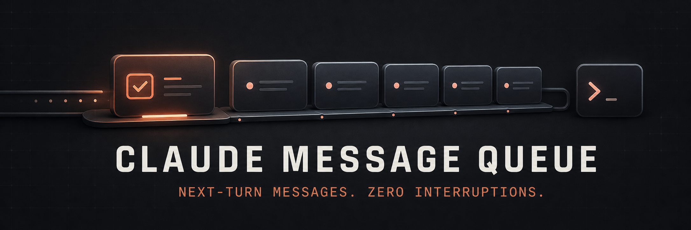
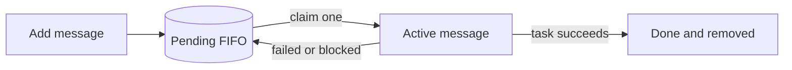

<!-- markdownlint-disable MD013 MD033 MD041 -->

<p align="center">
  
</p>

<p align="center">
  A durable, non-interrupting next-turn queue for Claude Code CLI and Claude Desktop Code.
</p>

<p align="center">
  <a href="https://github.com/imdewan/claude-message-queue/actions/workflows/test.yml"></a>
  <a href="./LICENSE"></a>
  
  
</p>

<p align="center">
  <a href="#quick-start">Quick start</a> ·
  <a href="#how-it-works">How it works</a> ·
  <a href="#commands">Commands</a> ·
  <a href="#cli-and-desktop">CLI & Desktop</a> ·
  <a href="#development">Development</a>
</p>

---

Claude already lets you submit another message while a turn is running: type it,
press <kbd>Enter</kbd>, and Claude finishes the current turn before starting the
next one. **Claude Message Queue** adds the durable layer around that behavior—a
FIFO backlog you can inspect, retry, and process across restarts and local Git
worktrees.

> [!IMPORTANT]
> This project never interrupts, cancels, or injects instructions into the
> current turn. Queued work starts only after the active work is finished.

## Quick start

### 1. Install the plugin

Run these commands in Claude Code:

```text
/plugin marketplace add imdewan/claude-message-queue
/plugin install queue@imdewan-claude-tools
```

Install it at **user scope** to make it available across projects. Start a new
session or run `/reload-plugins` if Claude asks you to reload.

### 2. Add future work

```text
/queue:add Run the full test suite and fix any failures
```

### 3. Inspect and run it

```text
/queue:list
/queue:run
```

That is the complete workflow. The item remains pending until `/queue:run`
claims it, and it is removed only after the queued request succeeds.

## Why use it?

| Capability | What it gives you |
| --- | --- |
| Non-interrupting | Current work always finishes before queued work begins. |
| Durable FIFO | Messages survive Claude restarts and execute in order. |
| Safe lifecycle | Each item moves through `pending → active → done`. |
| Failure recovery | Failed or blocked items return to `pending` instead of disappearing. |
| Worktree-aware | A repository and its local Git worktrees share one queue. |
| Concurrent-safe | Atomic moves, monotonic IDs, and PID locks protect simultaneous writers. |
| Local and private | Queue content stays on your machine with user-only permissions. |

## How it works



The runner claims exactly one message at a time. It never claims the next item
until the current queued request has completed successfully.

Queue identity is based on the repository's Git common directory. This means a
main checkout and its local worktrees share the same backlog, while unrelated
clones and non-Git directories remain isolated.

## Commands

Claude requires marketplace skills to use a namespace, so the extension exposes
the compact `/queue:*` command family.

| Command | Purpose |
| --- | --- |
| `/queue:add <message>` | Append a durable message without executing it. |
| `/queue:list` | Show pending and active messages. |
| `/queue:list peek` | Preview the oldest pending message. |
| `/queue:list <id>` | Show a specific pending or active message. |
| `/queue:run` | Run the next pending message. |
| `/queue:run <1-25>` | Run a bounded batch sequentially. |
| `/queue:run all` | Run up to 25 messages sequentially. |
| `/queue:manage retry <id>` | Return an active message to the pending queue. |
| `/queue:manage remove <id>` | Remove one message. |
| `/queue:manage clear` | Clear the queue after confirmation. |
| `/queue:manage doctor` | Check identity, paths, counts, and write access. |

### Native next-turn queue

For a temporary message that only needs to follow the current turn, no plugin
command is required:

1. Let Claude continue working.
2. Type the next request while the current turn is running.
3. Press <kbd>Enter</kbd>—do not press <kbd>Esc</kbd>.
4. Claude finishes the current turn and then processes the queued request.

### Durable queue from a terminal

The repository also includes a standalone `claude-queue` command. Install it
from a clone:

```bash
git clone https://github.com/imdewan/claude-message-queue.git
cd claude-message-queue
./scripts/install-cli.sh
```

It installs to `~/.local/bin/claude-queue` by default. Override the destination
with `CLAUDE_QUEUE_INSTALL_DIR`.

```bash
claude-queue add "Review the authentication changes"
claude-queue list

id="$(claude-queue claim)"
claude-queue show "$id"
claude-queue done "$id"
```

This is useful from Claude Desktop's integrated terminal: add an item while a
turn is running without touching the active conversation, then invoke
`/queue:run` later.

<details>
<summary><strong>Complete shell command reference</strong></summary>

```text
claude-queue add MESSAGE...
claude-queue add --stdin
claude-queue list
claude-queue count
claude-queue peek
claude-queue claim
claude-queue show ID
claude-queue done ID
claude-queue retry ID
claude-queue remove ID
claude-queue clear --yes
claude-queue path
claude-queue doctor
```

Use `--project DIR` to address another project and `--state-dir DIR` to use an
isolated state root.

</details>

## CLI and Desktop

Claude Desktop's **Code** tab and Claude Code CLI use the same underlying engine
and share user configuration, plugins, skills, and `CLAUDE.md`. Their session
histories remain separate.

| Capability | Claude Code CLI | Desktop Code tab |
| --- | :---: | :---: |
| Native send-now, run-next behavior | ✅ | ✅ |
| `/queue:*` plugin commands | ✅ | ✅ Local/SSH |
| Durable queue across restarts | ✅ | ✅ |
| Queue sharing across local worktrees | ✅ | ✅ |
| Standalone shell command | ✅ | ✅ Integrated terminal |

> [!NOTE]
> The ordinary Claude Desktop chat surface uses a separate extension system.
> Open the **Code** tab for Claude Code plugins.

## Storage and privacy

Queue state never lives in your repository. By default it is stored under:

```text
$XDG_STATE_HOME/claude-message-queue
```

or, when `XDG_STATE_HOME` is unset:

```text
~/.local/state/claude-message-queue
```

State files are created with user-only permissions. Override the state root when
you need additional isolation:

```bash
export CLAUDE_QUEUE_STATE_DIR=/path/to/private/state
```

## Design choices

- **No monitors:** Claude plugin monitors currently run only in interactive CLI
  sessions, so depending on one would break Desktop parity.
- **No channels:** channels inject events into a running session, which conflicts
  with the promise that queued work waits.
- **No personal skill install:** marketplace plugins remain portable and
  updateable, with Claude's standard `/queue:*` namespace.
- **No hidden deletion:** `clear` requires explicit confirmation and the shell
  command requires `clear --yes`.

## Requirements

- Claude Code `2.1.206` or newer; the newest stable version is recommended.
- macOS or Linux for the optional standalone Bash command.
- `git` is optional. Non-Git folders are scoped by canonical directory path.
- One of `shasum`, `sha256sum`, or `cksum` for project identity hashing.

## Development

Clone the project and run the complete check:

```bash
git clone https://github.com/imdewan/claude-message-queue.git
cd claude-message-queue
./scripts/check.sh
```

The suite covers:

- FIFO ordering and multiline payloads
- claim, complete, retry, remove, and clear lifecycles
- concurrent writers and monotonic IDs
- stale-lock recovery
- shared queues across Git worktrees
- manifest and skill validation through Claude Code

CI runs on both macOS and Ubuntu.

<details>
<summary><strong>Project structure</strong></summary>

```text
.
├── .claude-plugin/   # Plugin and marketplace manifests
├── assets/           # README artwork
├── bin/              # Standalone queue executable
├── scripts/          # Install and validation helpers
├── skills/           # /queue:add, list, manage, and run
└── tests/            # Lifecycle and concurrency tests
```

</details>

## Troubleshooting

<details>
<summary><strong>The /queue commands do not appear</strong></summary>

Open `/plugin`, verify `queue@imdewan-claude-tools` is enabled, then run
`/reload-plugins` or start a new local session.

</details>

<details>
<summary><strong>A message interrupted the current response</strong></summary>

Use <kbd>Enter</kbd> to queue another composer message. <kbd>Esc</kbd> explicitly
stops the current response. Update Claude Code and Claude Desktop if mid-turn
messages are being dropped.

</details>

<details>
<summary><strong>CLI and Desktop show different queues</strong></summary>

Run `claude-queue doctor` from both working directories and compare the
`Identity` line. Separate clones intentionally use separate queues.

</details>

## Community

- Read [CONTRIBUTING.md](./CONTRIBUTING.md) before opening a pull request.
- Report vulnerabilities through the process in [SECURITY.md](./SECURITY.md).
- Use [GitHub Issues](https://github.com/imdewan/claude-message-queue/issues)
  for reproducible bugs and focused feature requests.

## License

Claude Message Queue is released under the [MIT License](./LICENSE).

This is an independent open-source project and is not affiliated with or
endorsed by Anthropic.

## References

- [Claude Code Desktop](https://code.claude.com/docs/en/desktop)
- [Claude Code plugins](https://code.claude.com/docs/en/plugins)
- [Claude Code plugin reference](https://code.claude.com/docs/en/plugins-reference)
- [Claude Code changelog](https://code.claude.com/docs/en/changelog)
